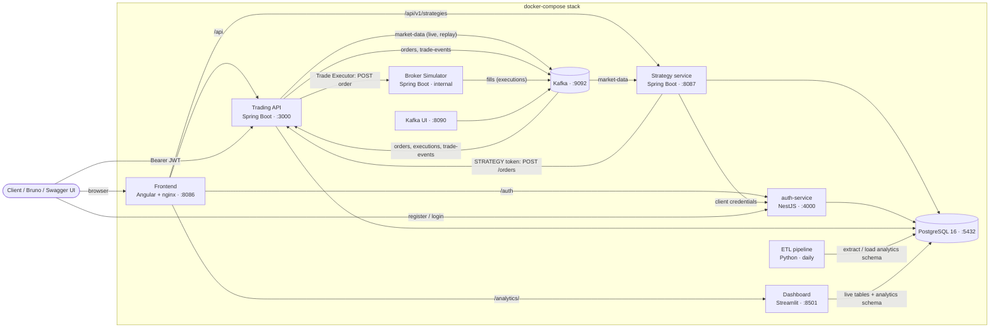

# TNS Capital — Enterprise Trading Platform

A full-stack trading platform built for the Fidelity Leap Program 2026. It manages trading
accounts, instruments, orders and positions, and processes orders asynchronously through
Kafka with a dead-letter queue for failures. An Angular web app serves traders and support
staff, a separate auth service issues the JWTs the trading API trusts, Strategy Lab runs
automated trading strategies, and a scheduled ETL pipeline feeds an admin analytics dashboard.

---

## Contents

- [Architecture](#architecture)
- [Tech stack](#tech-stack)
- [Repository layout](#repository-layout)
- [Getting started](#getting-started)
- [Market Data (Alpaca)](#market-data-alpaca)
- [Strategy Lab](#strategy-lab)
- [Using the API](#using-the-api)
- [Developing locally](#developing-locally)
- [Testing](#testing)
- [CI/CD pipeline](#cicd-pipeline)
- [Troubleshooting](#troubleshooting)
- [Further documentation](#further-documentation)
- [Contributing](#contributing)
- [Team](#team)

---

## Architecture



| Component | Responsibility |
|---|---|
| **Frontend** (`frontend/`) | Angular web app served by nginx, which also proxies the APIs and the dashboard on one origin. Traders trade, track orders and holdings and run Strategy Lab; support staff work in the account viewer, Support Inbox and Dead Letters pages. Has its own README. |
| **Trading API** (`src/`) | REST API for accounts, instruments, orders, positions, prices, the weekly newsletter, support chat and the DLQ. Validates JWTs locally using a shared HMAC secret. |
| **Broker Simulator** (`broker-simulator/`) | Stands in for a real broker: takes orders over a REST API and, after 0.5 to 2 seconds, fills each one at or better than its limit price and publishes the fill to the `executions` topic. Has its own README. |
| **Strategy service** (`strategy-service/`) | Strategy Lab (the Sprint 10 extension): backtests moving-average crossover and Bollinger-band rules on five years of daily prices, and runs the strategies traders switch on against 1-minute bars from the `market-data` topic, placing their orders through the trading API with its own `STRATEGY` token. Has its own README; see docs/DECISIONS.md 16. |
| **Auth service** (`shared/auth-service/`) | Registers users (opening a trading account for each), logs them in and issues access and refresh tokens. Passwords are hashed with Argon2id; refresh tokens are stored only as SHA-256 hashes in `refresh_tokens`. |
| **Kafka** | Carries order events (`orders`), fills from the broker (`executions`), trade lifecycle events (`trade-events`), each with a `.dlq` topic, and prices (`market-data`: live prices and replayed days, read by the strategy service). An audit consumer stores every trade event in `trade_event_log`. The API creates the topics on startup. |
| **PostgreSQL** | System of record. The `db/` image creates the schema, views, the services' login roles and seed data on first start. Each service connects with its own least-privilege role (`tns_api`, `tns_auth`, `tns_etl`, `tns_reader`, `tns_strategy`); the `DB_USER` owner is for administrators only. |
| **ETL** (`etl/`) | Extracts trades every day, transforms them into a star schema and loads them into the `analytics` schema. |
| **Dashboard** (`dashboard/`) | Streamlit admin dashboard: a Live view of the trading tables (what is happening now, what needs attention), a Batch view of the ETL's `analytics` schema (trends, per-user and strategy reports, data quality) and a Monitoring view. |
| **Monitoring** (`observability/`) | Optional VictoriaMetrics, vmalert, VictoriaLogs and Fluent Bit stack (Compose profile `observability`), shown in the dashboard's Monitoring view. Not drawn above. |

### Order lifecycle

1. `POST /api/v1/orders` checks that the caller owns the account and that the account and
   instrument exist, and that the `idempotencyKey` has not been used before (`409 ORD-409`
   if it has). It stores the order as `NEW`, publishes an `OrderEvent` to the `orders` topic
   (keyed by account ID, so orders for one account are processed in sequence) and returns
   **`202 Accepted`** with an `orderId`.
2. **Trade Executor.** `OrderMessageListener` consumes the event and `OrderService` runs the
   order through `OrderValidator` and reserves what it needs at its limit price (cash for a
   BUY, shares for a SELL; `ReservationService`), so no other order or withdrawal can use
   them. Nothing is spent yet. It then sends the order to the
   **Broker Simulator** over HTTP (`BrokerSimulatorClient`). The order stays `NEW`.
3. The broker works the order for 0.5 to 2 seconds and publishes the fill to the
   `executions` topic, at or better than the limit price.
4. **Settlement.** `ExecutionListener` consumes the fill. In one transaction `OrderService`
   releases the reservation and updates the cash balance and position at the fill price
   through the execution strategy
   (`BuyOrderStrategy` / `SellOrderStrategy`), records the fill in `executions` and marks the
   order `FILLED`. A trade event is published to `trade-events`.
5. Until the fill is settled the order is `NEW` and can be cancelled with
   `DELETE /api/v1/orders/{orderId}`, which releases its reservation; a fill that arrives
   later is ignored.
6. A failed order (insufficient funds or holdings, inactive account, broker unreachable,
   etc.) is saved as `REJECTED` with a reason and captured in the dead-letter queue
   (`dlq_messages` table). Admins and support can inspect, replay and dismiss these
   messages through `/api/v1/dlq` (support on the trading app's Dead Letters page); a
   replay sends the order to the broker again.
7. Clients poll `GET /api/v1/orders/{orderId}` to see the final status, and
   `GET /api/v1/orders/{orderId}/events` for its history.

Order statuses: `NEW`, `FILLED`, `REJECTED`, `CANCELLED`.

---

## Tech stack

| Area | Technology |
|---|---|
| Frontend | Angular 19, TypeScript, nginx; API clients generated from the OpenAPI contracts |
| Trading API, broker simulator, strategy service | Java 21, Spring Boot 3.5, Spring Security (OAuth2 resource server), Spring Data JPA, MyBatis, Spring Kafka, springdoc-openapi |
| Auth service | Node.js 22, NestJS 11, TypeScript, Argon2, `pg` |
| Messaging | Apache Kafka (Confluent Platform 7.5 image) in KRaft mode, Kafka UI |
| Database | PostgreSQL 16 |
| ETL | Python 3.12, pandas, psycopg2, schedule |
| Dashboard | Python 3.12, Streamlit, Plotly, pandas |
| Market data | Alpaca market data API (live trades, bars, snapshots, news) |
| Monitoring | VictoriaMetrics, vmalert, VictoriaLogs, Fluent Bit |
| Testing | JUnit 5, Mockito, Testcontainers, JaCoCo, Jest, Supertest, pytest, Karma and Jasmine, Playwright |
| CI/CD and quality | Jenkins, SonarQube, Gitleaks, Semgrep, Trivy |
| Containers | Docker, Docker Compose |

---

## Repository layout

```
TNS-Capital/
├── src/main/java/com/neueda/leap/   Trading API (Spring Boot)
│   ├── controllers/                 REST endpoints and the global exception handler
│   ├── services/                    Business logic: orders, accounts, reservations, DLQ, newsletter, support chat
│   ├── strategies/                  Buy and sell execution strategies
│   ├── kafka/                       Order/trade event publishers, order listener, event types
│   ├── execution/                   Broker Simulator client (the Trade Executor's outbound call)
│   ├── marketdata/                  Live prices, bars and news from Alpaca behind PriceProvider; market replay
│   ├── metrics/                     Prometheus metrics for the monitoring stack
│   ├── security/                    JWT configuration and account ownership checks
│   ├── model/  dtos/  enums/        JPA entities, request/response records, enums
│   ├── repositories/  mappers/      Spring Data JPA repositories and MyBatis mappers
│   ├── exceptions/                  Domain exceptions mapped to API error codes
│   └── config/                      Kafka, OpenAPI, MyBatis, market data and newsletter configuration
├── src/test/                        Unit tests and *IT integration tests (Testcontainers)
├── frontend/                        Angular app, served by nginx; e2e/ holds the Playwright tests
├── shared/auth-service/             NestJS auth service (has its own README)
├── broker-simulator/                Spring Boot Broker Simulator: fills orders after a delay
├── strategy-service/                Spring Boot Strategy Lab service: rules, backtests, live engine
├── db/                              PostgreSQL image: tables/, views/, roles/, seed data/
├── etl/                             Python ETL pipeline (has its own README)
├── dashboard/                       Streamlit analytics dashboard (has its own README)
├── bruno/                           Bruno API collection for manual testing
├── contracts/                       OpenAPI contracts for the auth, trading and strategy APIs
├── observability/                   Monitoring stack config: scrape targets, alert rules, log shipping
├── ci/                              Test scripts Jenkins runs (Python suites, e2e stack)
├── docs/                            Design decisions, security guide and OWASP review, SonarQube, diagrams
├── docker-compose.yml               Full local stack
├── Dockerfile                       Multi-stage build for the trading API
├── Jenkinsfile                      CI pipeline
└── .env.example                     Template for secrets and settings
```

---

## Getting started

These steps take a fresh clone to a running stack.

### Prerequisites

| Tool | Version | Needed for |
|---|---|---|
| [Git](https://git-scm.com/) | any recent | cloning the repo |
| [Docker](https://docs.docker.com/get-docker/) with Docker Compose | Docker 24+ | running the stack and the integration tests |
| JDK | 21 | building and testing the API outside Docker (optional) |
| Maven | 3.8+ | as above (optional) |
| Node.js | 22+ | developing the auth service or the frontend (optional) |
| Python | 3.12 | developing the ETL pipeline (optional) |

The full stack uses about 3.5 GB of memory. Give Docker Desktop at least 4 GB.

> The commands below use `docker compose` (Compose v2). If you have the older standalone
> tool, use `docker-compose` instead; the arguments are the same.

### 1. Clone the repository

```bash
git clone https://github.com/NathanCarr10/TNS-Capital.git
cd TNS-Capital
```

### 2. Create your `.env` file

No secrets are committed, and the stack refuses to start without them.

```bash
cp .env.example .env
```

Edit `.env` and set:

| Variable | Description |
|---|---|
| `DB_USER` | PostgreSQL user. The default `tns-capital-db-user` is fine. |
| `DB_PASSWORD` | Any password for the local database. |
| `JWT_SECRET` | Shared secret used by the auth service to sign tokens and by the API, strategy service and dashboard to verify them. At least 32 bytes; generate one with `openssl rand -hex 32`. All three refuse to start (or to sign anyone in) with the `change-me` placeholder. |
| `ADMIN_PASSWORD` | Password of the admin account (role `ADMIN`: the analytics dashboard and operations), which the auth service creates when it starts (nothing is seeded). It signs in as `ADMIN_EMAIL` (default `admin@tns-capital.local`). At least 12 characters. Change it and restart the auth service to rotate it. |
| `SUPPORT_PASSWORD` | Password of the support account (role `SUPPORT`: the trading app's account viewer, Support Inbox and Dead Letters), created the same way and signing in as `SUPPORT_EMAIL` (default `support@tns-capital.local`). At least 12 characters, and not the `ADMIN_PASSWORD`. |
| `STRATEGY_CLIENT_SECRET` | The strategy service's secret for logging in to the auth service, so [Strategy Lab](#strategy-lab) strategies can place orders. At least 32 characters; generate one with `openssl rand -hex 32`. The stack starts without it, but strategies cannot trade. |
| `ALPACA_API_KEY_ID`, `ALPACA_API_SECRET_KEY` | Optional market data keys ([Market Data](#market-data-alpaca)). Without them there are no live prices (orders must include a price), no price history for charts and backtests, no news, no newsletter and no Strategy Lab replay. |
| `DEMO_PASSWORD` | Optional. Creates the demo trader `jane.doe@example.com`, linked to the seeded `ACC-DEMO-JANE` account with a short trading history, so there is something to show straight away. |

`.env.example` has a quick start at the top and lists every other setting with its default:
host ports, log formats, the auth rate limit, broker fill delays, the ETL schedule, the
newsletter schedule and the monitoring profile. Proxy settings for the auth service's rate
limit are in [shared/auth-service/README.md](shared/auth-service/README.md#rate-limiting).

### 3. Start the stack

```bash
docker compose up -d --build
```

The first build downloads base images and Maven/npm dependencies, so it takes a few
minutes. Compose waits on health checks: Kafka and PostgreSQL (which creates the schema
and seed data) start first, then the auth service and broker simulator, then the trading API
and strategy service, and finally the web app.

Check that everything is up:

```bash
docker compose ps
```

All services should show `running` (and `healthy` where a health check exists). Follow the
API's startup with `docker compose logs -f app`.

### 4. Services and ports

| Service | URL | Notes |
|---|---|---|
| Web app | http://localhost:8086 | Angular frontend; nginx forwards `/api`, `/auth`, `/api/v1/strategies` and `/analytics/` to the services. Strategy Lab is at `/strategies` |
| Trading API | http://localhost:3000 | All endpoints need a bearer token, except `/actuator/health` (details for admins only). This machine only: other machines use port 8086 |
| Swagger UI | http://localhost:3000/swagger-ui.html | Public. Click **Authorize** and paste an access token |
| OpenAPI spec | http://localhost:3000/v3/api-docs | Public |
| Strategy service | http://localhost:8087 | Strategy Lab API; Swagger UI at `/swagger-ui.html`. This machine only: browsers use port 8086 |
| Auth service | http://localhost:4000 | `GET /health` is public. This machine only |
| Auth Swagger UI | http://localhost:4000/docs | Public. JSON at `/docs-json` |
| Kafka UI | http://localhost:8090 | Browse topics and messages (read-only, this machine only) |
| Dashboard | http://localhost:8086/analytics/ | Admin analytics (Streamlit); also directly on http://localhost:8501/analytics/ from this machine. Run the ETL once to fill the batch view |
| PostgreSQL | `localhost:5432`, database `tns_capital` | Credentials from `.env` |
| Kafka | `kafka:9092` | Reachable from inside the Compose network (see [Troubleshooting](#troubleshooting)) |

### 5. Verify it works

```bash
# Auth service is up
curl http://localhost:4000/health
# -> {"status":"up"}

# Log in as the admin (ADMIN_PASSWORD from .env) and keep the access token
source .env
TOKEN=$(curl -s -X POST http://localhost:4000/auth/login \
  -H "Content-Type: application/json" \
  -d "{\"email\":\"${ADMIN_EMAIL:-admin@tns-capital.local}\",\"password\":\"$ADMIN_PASSWORD\"}" \
  | python3 -c 'import sys, json; print(json.load(sys.stdin)["accessToken"])')

# Trading API health: public; an admin token adds the details (database, disk)
curl -s http://localhost:3000/actuator/health
# -> {"status":"UP"}
curl -s http://localhost:3000/actuator/health -H "Authorization: Bearer $TOKEN"
# -> {"status":"UP","components":{"db":{"status":"UP", ...}, ...}}

# Traders' accounts are support's, not the admin's: log in as support to read one
SUPPORT_TOKEN=$(curl -s -X POST http://localhost:4000/auth/login \
  -H "Content-Type: application/json" \
  -d "{\"email\":\"${SUPPORT_EMAIL:-support@tns-capital.local}\",\"password\":\"$SUPPORT_PASSWORD\"}" \
  | python3 -c 'import sys, json; print(json.load(sys.stdin)["accessToken"])')
curl -s http://localhost:3000/api/v1/accounts/1/balance -H "Authorization: Bearer $SUPPORT_TOKEN"
# -> {"balance":5000.00,"reservedCash":0.00,"availableCash":5000.00}
#    reservedCash is held for open orders; only availableCash can be traded or withdrawn
```

### Stopping and resetting

```bash
docker compose down        # stop the stack, keep the database
docker compose down -v     # stop the stack and delete the database volume
```

The database scripts in `db/` only run when the data volume is empty. **After pulling
changes to `db/tables`, `db/roles` or `db/data`, run `docker compose down -v` and start again**
so PostgreSQL rebuilds the schema. The same applies to `DB_PASSWORD` and the services'
`DB_*_PASSWORD`s: PostgreSQL only reads them when the volume is created, so changing them later
locks the services out until you reset.

The seed data is 30 instruments (US stocks and ETFs such as `AAPL`, `MSFT`, `NVDA` and `SPY`)
and six weeks of sample trading on ten accounts (ACC-1001 to ACC-1010), dated back from the day the
database is created, for the analytics. No logins are seeded: register a trader (it gets a new
account to deposit into), sign in as the support user with `SUPPORT_PASSWORD` to look after
accounts in the trading app, or as the admin with `ADMIN_PASSWORD` for the analytics dashboard.
Set `DEMO_PASSWORD` to also get the Jane Doe demo trader.

### ETL pipeline (optional)

A scheduled Python pipeline in [`etl/`](etl/README.md) extracts trade data from PostgreSQL, transforms it into a reporting star schema and loads it into the `analytics` schema. It also loads daily price history for every instrument from Alpaca into `analytics.fact_daily_prices`. See [etl/README.md](etl/README.md).

---

## Market Data (Alpaca)

Live prices and price history both come from the [Alpaca market data API](https://docs.alpaca.markets/docs/about-market-data-api), so they agree with each other.

- **Live price pool** (`marketdata/`): `AlpacaPriceStream` subscribes to live trades for the tradable instruments over a WebSocket, and `LivePriceService` keeps the latest price of each one in memory. A price not updated for 60 seconds (or one the stream does not cover) is refreshed from Alpaca's REST API when it is next needed.
- **Orders:** `price` is optional in `POST /api/v1/orders`. Without it, the order is priced at the live price (rounded to the cent) when it is accepted, and the price is returned in the response. If no live price is available, the API returns `503 PRC-503`.
- **`GET /api/v1/prices/{symbol}`** returns the latest price of an instrument.
- **`GET /api/v1/prices?symbols=AAPL,MSFT`** returns dashboard quotes for up to 50 instruments: the latest price plus the previous close, daily change and percentage change. Previous closes come from Alpaca snapshots and are cached for 15 minutes. A symbol with no live price is returned with null price fields.
- **`GET /api/v1/prices/{symbol}/bars?timeframe=1Day&limit=100`** returns the most recent OHLC bars (oldest first) for the candlestick chart. `timeframe` is `15Min`, `1Hour` or `1Day`; `limit` is 1 to 1000. If no bars are available, the API returns `503 MKT-503`.
- **`GET /api/v1/prices/{symbol}/news`** returns up to 10 headlines about an instrument from the last 7 days, newest first, from Alpaca's News API (Benzinga) with the same keys. The **Trade page** shows them in a scrolling ticker above the breadcrumb, which pauses on hover, keyboard focus or its pause button, and becomes a still list with *Reduce motion* in Settings. News is cached for 5 minutes per symbol, only `https://` links are kept, and headlines are shown as text. Without news or market data keys the list is empty and the ticker is left out.
- **Positions:** `marketValue` in the position endpoints is the quantity at the latest live price, or `null` when no live price is available.
- **Setup:** create free API keys at [alpaca.markets](https://alpaca.markets) and set `ALPACA_API_KEY_ID` and `ALPACA_API_SECRET_KEY` in `.env`. Without keys, the pool is off and orders must include a price.
- **Free plan limits:** the live feed is IEX only (about 2.5% of US volume), up to 30 streamed symbols, and one stream connection per account, so only one app instance can stream at a time. Set `ALPACA_FEED=sip` on a paid plan for all exchanges.

### Weekly newsletter

Every Friday at 17:00 New York time, after the US market closes, the API publishes a newsletter
that every signed-in user reads on the **Market Movers** page (`/market-movers`; `/newsletter` redirects there):

- **Movers:** the 5 tradable instruments that rose the most this week and the 5 that fell the
  most, from Alpaca daily bars. A week's change runs from the close before Monday to the latest close.
  Without prices nothing is published and the API logs an error.
- **One issue per week**, stored as a JSONB snapshot in `newsletter_issues` and never changed
  afterwards ([DECISIONS.md](docs/DECISIONS.md) #17).
- **Support staff can preview** the week so far with **Preview this week's issue** on the page, or
  `GET /api/v1/newsletters/preview`. A preview is never saved, so it cannot take the place of the
  Friday issue.
- **Publishing early (demos):** with `NEWSLETTER_EARLY_PUBLISH=true` in `.env`, support can also
  click **Publish this issue** on a preview (`POST /api/v1/newsletters/publish`). That issue is
  then the week's issue and the Friday run skips the week. It is off by default (`403 NWS-403`);
  keep it off in production. To undo a demo locally, delete the row from `newsletter_issues` as the
  database owner.
- **Schedule:** `NEWSLETTER_CRON` in `.env` (a Spring cron in New York time; `-` switches it off).
  The number of movers is set under `newsletter.*` in `application.yml`.
- **Existing database:** the table is created when the `postgres` volume is new. To add it to an
  existing one without losing data, run as the database owner:

  ```bash
  source .env
  docker compose exec -T postgres psql -U "$DB_USER" -d tns_capital < db/tables/13_newsletter_issues.sql
  docker compose exec -T postgres psql -U "$DB_USER" -d tns_capital -c "GRANT SELECT, INSERT ON newsletter_issues TO tns_api;"
  ```

  A database created before issues became movers-only still has a `news` column, which the API
  no longer fills. Drop it, or publishing fails:

  ```bash
  docker compose exec -T postgres psql -U "$DB_USER" -d tns_capital -c "ALTER TABLE newsletter_issues DROP COLUMN IF EXISTS news;"
  ```

---

## Strategy Lab

Strategy Lab (http://localhost:8086/strategies) is the platform's Sprint 10 extension: automated
strategy execution (docs/DECISIONS.md 16).

1. Set `STRATEGY_CLIENT_SECRET` in `.env` (`openssl rand -hex 32`): the strategy service logs in with
   it to place orders. Without it, strategies cannot trade.
2. Run the ETL once (`docker compose run --rm etl python pipeline.py`) so there are five years of daily
   prices to backtest on.
3. Pick a rule and **Run backtest**: the strategy's return against buying and holding, its largest
   drawdown and its trades.
4. **Save strategy**, then **Switch on**. It trades on each 1-minute bar of its symbol while the market is
   open. Outside market hours, **Replay** a past day (needs the Alpaca keys): its bars stream at up to 50 a
   second and the strategy places real orders, priced at the live market price.
5. The strategy's signals, with each order's status, show under it; a toast announces every trade on any
   page. Support staff see every strategy read-only, and the admins' analytics dashboard shows strategy
   orders next to everyone else's.

## Using the API

### Authentication

Every trading API endpoint except Swagger and `/actuator/health` needs an access token from
the auth service:

```
Authorization: Bearer <accessToken>
```

Login returns an access token, valid for 15 minutes, and a refresh token, valid for 7 days.
When the access token expires, send the refresh token to `POST /auth/refresh` to get a new
pair. Each refresh token works once: reusing a spent one ends that login session. A user can
be logged in on several devices at once. See
[shared/auth-service/README.md](shared/auth-service/README.md) for the token claims, refresh
and logout.

Every user signs in with their email address.

| User | Password | Role | Access |
|---|---|---|---|
| `support@tns-capital.local` (`SUPPORT_EMAIL`) | `SUPPORT_PASSWORD` from `.env` | `SUPPORT` | The trading app's account viewer: every account read-only, suspending and reactivating them, opening accounts, adding and changing instruments, answering traders in the Support Inbox, and reviewing, replaying and dismissing dead letters |
| `admin@tns-capital.local` (`ADMIN_EMAIL`) | `ADMIN_PASSWORD` from `.env` | `ADMIN` | The analytics dashboard, the DLQ and the actuator's metrics; no traders' accounts (see [decision 10](docs/DECISIONS.md#10-roles)) |
| `jane.doe@example.com` (optional) | `DEMO_PASSWORD` from `.env` | `USER` | The seeded demo account `ACC-DEMO-JANE` |
| A user you register | your own | `USER` | Only the account opened at registration |

### Example: register, fund and trade

```bash
# 1. Register a user; this also opens a trading account with a zero balance
ACCOUNT_ID=$(curl -s -X POST http://localhost:4000/auth/register \
  -H "Content-Type: application/json" \
  -d '{"email":"trader1@example.com","password":"password123","holderName":"Ada Lovelace"}' \
  | python3 -c 'import sys, json; print(json.load(sys.stdin)["accountId"])')
# The response is {"id":...,"email":"trader1@example.com",...,"accountId":...,"accountNumber":"ACC-U00000N"}

# 2. Log in
TOKEN=$(curl -s -X POST http://localhost:4000/auth/login \
  -H "Content-Type: application/json" \
  -d '{"email":"trader1@example.com","password":"password123"}' \
  | python3 -c 'import sys, json; print(json.load(sys.stdin)["accessToken"])')

# 3. Deposit cash
curl -s -X POST http://localhost:3000/api/v1/accounts/$ACCOUNT_ID/deposit \
  -H "Authorization: Bearer $TOKEN" -H "Content-Type: application/json" \
  -d '{"amount": 5000.00}'

# 4. Place a buy order; returns 202 with an orderId. Leave out "price" to buy at the live
#    price (needs the Alpaca keys); with a price, it is a limit order
curl -s -X POST http://localhost:3000/api/v1/orders \
  -H "Authorization: Bearer $TOKEN" -H "Content-Type: application/json" \
  -d '{"accountId":'"$ACCOUNT_ID"',"symbol":"AAPL","side":"BUY","quantity":10,"price":250.00,
       "idempotencyKey":"'"$(uuidgen)"'"}'

# 5. Poll the order until it is FILLED or REJECTED (it is NEW until the broker fills it)
curl -s http://localhost:3000/api/v1/orders/<orderId> -H "Authorization: Bearer $TOKEN"

# 6. See the resulting position
curl -s http://localhost:3000/api/v1/accounts/$ACCOUNT_ID/positions -H "Authorization: Bearer $TOKEN"
```

The seed has 30 instruments, all tradable except `ARKK`: large US stocks (`AAPL`, `MSFT`,
`GOOGL`, `AMZN`, `NVDA`, `META`, `TSLA`, `JPM` and more) and ETFs (`SPY`, `QQQ`, `VTI`, `GLD`,
`TLT` and more). See `db/data/02_instruments_seed.sql`. With live prices on, a limit price that
is not marketable (a BUY below or a SELL above the live price) is refused with `422 ORD-422`.

### Endpoint overview

All paths are under `/api/v1`. Swagger UI documents the request and response bodies.

| Resource | Endpoints |
|---|---|
| Accounts | `GET /accounts` · `POST /accounts` (SUPPORT) · `GET/PATCH/DELETE /accounts/{id}` · `PUT /accounts/{id}/status` (SUPPORT: suspend or reactivate) · `GET /accounts/{id}/balance` · `POST /accounts/{id}/deposit` · `POST /accounts/{id}/withdraw` · `GET /accounts/{id}/positions` · `GET /accounts/{id}/orders` |
| Orders | `POST /orders` · `GET /orders` · `GET /orders/{orderId}` · `DELETE /orders/{orderId}` (cancel) · `GET /orders/{orderId}/events` (status history) · `GET /orders/history/{orderId}` · `GET /orders/{accountId}/history` |
| Positions | `GET /positions/{accountId}` · `GET /positions/{accountId}/{symbol}` |
| Instruments | `GET /instruments` · `GET /instruments/{symbol}` · `POST /instruments` (SUPPORT) · `PUT /instruments/{symbol}` (SUPPORT) |
| Prices | `GET /prices?symbols=` · `GET /prices/{symbol}` · `GET /prices/{symbol}/bars` · `GET /prices/{symbol}/news` |
| Market replay | `POST /market-data/replays` (replay a past day's 1-minute bars on `market-data`) · `GET /market-data/replays/current` · `DELETE /market-data/replays/current` |
| Strategies (strategy service) | `GET/POST /strategies` · `GET/DELETE /strategies/{id}` · `PUT /strategies/{id}/status` (ACTIVE or PAUSED) · `GET /strategies/{id}/signals` · `GET /strategies/activity?since=` · `GET /strategies/performance` · `POST /strategies/backtests` |
| Newsletter | `GET /newsletters` · `GET /newsletters/{id}` · `GET /newsletters/preview` (SUPPORT) · `POST /newsletters/publish` (SUPPORT, demos only) |
| Support chat | `GET/POST /support/conversations` · `POST /support/conversations/{id}/messages` · `GET /support/conversations/{id}/events` (Server-Sent Events) · `POST /support/conversations/{id}/close` (SUPPORT) · `GET /support/conversations/notifications/unread` (SUPPORT) · `POST /support/conversations/notifications/read` (SUPPORT) |
| Dead-letter queue (ADMIN, SUPPORT) | `GET /dlq/messages` · `GET /dlq/messages/{id}` · `POST /dlq/messages/{id}/replay` · `DELETE /dlq/messages/{id}` · `GET /dlq/statistics` |

Traders can only see and act on their own account and their own support conversations; support
staff see every account and conversation. Errors use one format:

```json
{ "errorCode": "AUTH-401", "message": "Unauthorised or invalid token", "timestamp": "..." }
```

Every error code is listed in [docs/SECURITY_GUIDE.md](docs/SECURITY_GUIDE.md#exception-handling-map).

### Support chat

Traders open a conversation from the chat widget on any page of the trading app, and support
staff answer in the **Support Inbox** (`/support`), which shows an unread count in the sidebar.
New messages arrive live over Server-Sent Events; each stream lasts up to 15 minutes, and the app
reconnects with a fresh token. Only support staff can close a conversation, and a closed one
accepts no more messages (`409 SUP-409`).

### Logs

In Docker the trading API logs one JSON object per line (Spring Boot's structured logging, in
Elastic Common Schema), so tools such as Elasticsearch or CloudWatch can filter by level,
logger or message. Read them with `docker compose logs app`, or pretty-print with
`docker compose logs --no-log-prefix app | jq`. Set `LOG_FORMAT=logstash` (or `gelf`) in
`.env` for another format. Running the API with `mvn spring-boot:run` keeps the usual
plain-text lines. The auth service logs JSON lines in Docker too (`AUTH_LOG_FORMAT`, default `json`).

### Monitoring (optional)

A small monitoring stack (~90 MB) of metrics, alerts and every service's logs starts with the
rest of the stack, through `COMPOSE_PROFILES=observability` in `.env` (from `.env.example`). Admins see it in the analytics dashboard's
**Monitoring** view. See [observability/README.md](observability/README.md).

### Bruno collection

The `bruno/` folder is a ready-made [Bruno](https://www.usebruno.com/) collection covering
the auth, account, order, price, newsletter and Strategy Lab endpoints, plus **API Health** (no
token needed).

1. Open the `bruno/` folder as a collection in Bruno and select the **local** environment.
2. Change `email` if you like, and set the secret variables `password` (and `accountId` once
   you have one).
3. Run **auth → Register**, then **auth → Login**. Login saves the tokens into the
   environment, and every other request sends the access token automatically.

---

## Developing locally

You can run the infrastructure in Docker and the service you are working on from your IDE
or terminal.

### Trading API

```bash
# Start the infrastructure the API needs
docker compose up -d postgres kafka auth-service

# The broker simulator has no host port in Compose, so run it from source too (port 8085)
(cd broker-simulator && mvn spring-boot:run) &

# Run the API from source with the values from .env
set -a; source .env; set +a
export SPRING_DATASOURCE_PASSWORD="$DB_PASSWORD"
mvn spring-boot:run
```

The API listens on port 3000 and connects to the database as the `DB_USER` owner by default. Because Kafka advertises itself as `kafka:9092`, a process
running on your host needs that name to resolve. Add this line to your hosts file
(`/etc/hosts`, or `C:\Windows\System32\drivers\etc\hosts` on Windows):

```
127.0.0.1 kafka
```

Build the jar without running tests:

```bash
mvn clean package -DskipTests      # -> target/tns-capital-skeleton.jar
```

### Auth service

```bash
cd shared/auth-service
npm ci
npm run build
set -a; source ../../.env; set +a   # JWT_SECRET, the staff passwords, DB_USER and DB_PASSWORD
DB_HOST=localhost npm start
```

Stop the `auth-service` container first (`docker compose stop auth-service`) so port 4000
is free.

### ETL pipeline

```bash
cd etl
pip install -r requirements-dev.txt
python pipeline.py              # run once
python pipeline.py --schedule   # run daily at ETL_SCHEDULE_TIME
```

See [etl/README.md](etl/README.md) for settings and the reporting schema.

---

## Testing

| Suite | Command | Notes |
|---|---|---|
| API unit tests | `mvn test` | No external services needed |
| API unit and integration tests | `mvn verify` | `*IT` tests start PostgreSQL and Kafka with Testcontainers, so Docker must be running. JaCoCo writes a coverage report to `target/site/jacoco/` |
| Broker simulator | `cd broker-simulator && mvn test` | No external services needed |
| Strategy service | `cd strategy-service && mvn verify` | Unit tests, then `StrategyServiceIT` against Postgres (built from `db/`) and Kafka with Testcontainers; Docker must be running |
| Auth service | `cd shared/auth-service && npm ci && npm test` | `users.service.spec.ts` also runs against a real database when `DB_HOST` is set |
| Auth service, with its database tests | `ci/auth-tests.sh` | Needs only Docker: starts a throwaway Postgres from `db/` and removes it afterwards. Writes `coverage/lcov.info` |
| ETL | `cd etl && pip install -r requirements-dev.txt && python -m pytest` | Database integration tests run only with `ETL_IT=1`; see [etl/README.md](etl/README.md) |
| Dashboard | `cd dashboard && pip install -r requirements.txt -r requirements-dev.txt && python -m pytest` | The `data.py` database tests run only with `DASHBOARD_IT=1` |
| ETL and dashboard, with their database tests | `ci/python-tests.sh etl` / `ci/python-tests.sh dashboard` | Needs only Docker: starts a throwaway Postgres and removes it afterwards. Writes `coverage.xml` |
| Frontend unit tests | `cd frontend && npm ci && npm test` | Karma and Jasmine in Chrome; generates the API clients first (needs Java 11+) |
| End-to-end (Playwright) | `ci/e2e-tests.sh` | Needs only Docker: builds and starts a throwaway copy of the whole stack with no host ports, runs [frontend/e2e](frontend/e2e) in the Playwright image, then removes it. Against your own running stack instead: `cd frontend && npx playwright install chromium && npm run e2e` (see [frontend/README.md](frontend/README.md#end-to-end-tests)) |

---

## CI/CD pipeline

Jenkins runs the [`Jenkinsfile`](Jenkinsfile) on every branch and pull request:

| Stage | What it does |
|---|---|
| Checkout | Checks out the branch under test |
| Secret Scan | Gitleaks scans the branch's git history. Known false positives go in `.gitleaksignore` |
| SAST | Semgrep with the Java and OWASP Top 10 rule packs. Fails on ERROR-severity findings |
| Build Image | Packages the jar and builds the Docker image, tagged with the build number |
| Test | `mvn verify` (unit and integration tests); results published as JUnit reports |
| Broker Simulator Tests | `mvn test` in `broker-simulator/` |
| Strategy Service Tests | `mvn verify` in `strategy-service/` (unit tests and the Testcontainers IT), with JaCoCo coverage for SonarQube |
| ETL Tests | The ETL pytest suite, including its Postgres integration tests against a throwaway database, with coverage (`ci/python-tests.sh etl`) |
| Dashboard Tests | The dashboard's tests (insights, the headless Streamlit page, `data.py` against a throwaway database), with coverage |
| Auth Service Tests | The auth service's Jest suite in a `node:22-alpine` container, including its database tests against a throwaway Postgres, with coverage (`ci/auth-tests.sh`) |
| Frontend Tests | The Angular unit tests in headless Chromium with coverage, then a production build |
| E2E Tests | The Playwright journeys against a throwaway copy of the whole stack (`ci/e2e-tests.sh`); the report and traces of failed tests are archived |
| SonarQube Analysis | Analyses every component (the Java API and strategy service, the Python ETL and dashboard, the Angular frontend and the NestJS auth service), uploads their coverage and waits for the quality gate |
| Dependency Scan | Trivy scans the manifests and the built images (API, auth service, strategy service). Fails on fixable CRITICAL CVEs. Accepted risks go in `.trivyignore` |

Security reports (SARIF) are archived with every build, and the build's images and Docker build
cache are pruned afterwards. See [docs/SONARQUBE.md](docs/SONARQUBE.md) for the quality gate and
[docs/SECURITY_GUIDE.md](docs/SECURITY_GUIDE.md#16-ci-security-scanning-devsecops) for running the
security scans locally.

---

## Troubleshooting

| Problem | Fix |
|---|---|
| `required variable DB_PASSWORD is missing`, `set JWT_SECRET in .env`, `set ADMIN_PASSWORD in .env` or `set SUPPORT_PASSWORD in .env` | Create `.env` from `.env.example` and fill in the values ([step 2](#2-create-your-env-file)). |
| Auth service or API exits on startup | `JWT_SECRET` must be at least 32 bytes and not the `change-me` placeholder; `ADMIN_PASSWORD` and `SUPPORT_PASSWORD` at least 12 characters and different. Check `docker compose logs auth-service`. |
| The admin or support user cannot sign in | Sign in with the email (`ADMIN_EMAIL` / `SUPPORT_EMAIL`, by default `admin@tns-capital.local` and `support@tns-capital.local`), not a username, and the password from `.env`. The auth service sets both at startup, so restart it after changing them. |
| `401 AUTH-401` from the API | The token is missing, expired, signed with a different secret, or not an access token from the auth service (`iss`, `typ`). Log in again, and make sure the API and auth service use the same `JWT_SECRET`. |
| `403 AUTH-403` | You are accessing an account that is not yours, or an ADMIN-only endpoint. |
| Hibernate `Schema-validation` errors, or missing tables/columns | The database volume predates a schema change. Run `docker compose down -v` and start again. |
| `password authentication failed for user "tns_api"` (or `tns_auth`, `tns_etl`, `tns_reader`, `tns_strategy`), or `role ... does not exist` | The database volume predates the services' roles, or a `DB_*_PASSWORD` changed after it was created. Run `docker compose down -v` and start again. |
| Port already in use (3000, 4000, 8086, 8087, 5432, 8090, 8501, 9092) | Stop the program using the port. The web app, dashboard and Kafka UI ports can be changed in `.env` (`FRONTEND_PORT`, `DASHBOARD_PORT`, `KAFKA_UI_PORT`); the others in `docker-compose.yml`. |
| `422 ORD-422` when placing an order | The limit price is not marketable at the live price (a BUY below it, a SELL above it). Leave out `price` to trade at the live price. |
| `503 PRC-503` when placing an order without a price | No live price is available: the Alpaca keys are not set, or the stream has not priced the symbol yet. Send a `price`. |
| API running on the host cannot reach Kafka | Add `127.0.0.1 kafka` to your hosts file ([Developing locally](#trading-api)). |
| Containers killed or restarting | Docker needs at least 4 GB of memory for the full stack. |
| Order stays `NEW` | Check the consumer with `docker compose logs app`, and the `orders` topic in Kafka UI. |
| `503 SYS-503` when placing an order | Kafka did not acknowledge the order within 5 seconds, so it was stored as `REJECTED` and not executed. Check `docker compose ps kafka`, then place it again with a new `idempotencyKey`. |

---

## Further documentation

| Document | Contents |
|---|---|
| [docs/DECISIONS.md](docs/DECISIONS.md) | Design decisions and where the build deliberately differs from the spec |
| [docs/BusinessLogic.md](docs/BusinessLogic.md) | The original Sprint 5 domain design: class diagram and buy/sell sequence diagrams |
| [docs/diagrams/ER-DIAGRAM.md](docs/diagrams/ER-DIAGRAM.md) | Database ER diagram |
| [docs/diagrams/CLASS-DIAGRAM.md](docs/diagrams/CLASS-DIAGRAM.md) | Domain model, services and strategies, exceptions (UML class diagrams) |
| [docs/diagrams/ORDER-FLOW.md](docs/diagrams/ORDER-FLOW.md) | Order flow sequence diagrams: a BUY that fills, a rejection and the DLQ, cancelling |
| [docs/diagrams/STRATEGY-LAB.md](docs/diagrams/STRATEGY-LAB.md) | Strategy Lab: how a strategy trades (sequence) and its rules and engine (classes) |
| [docs/SECURITY_GUIDE.md](docs/SECURITY_GUIDE.md) | Security measures: authentication, roles, validation, error codes, headers, CI scanning |
| [docs/OWASP_REVIEW.md](docs/OWASP_REVIEW.md) | OWASP Top 10 review: every finding with its evidence and disposition |
| [docs/MARKET_DATA_PROVIDER_EVALUATION.md](docs/MARKET_DATA_PROVIDER_EVALUATION.md) | Why Alpaca was chosen for market data |
| [docs/SONARQUBE.md](docs/SONARQUBE.md) | SonarQube quality gate and its setup |
| [frontend/README.md](frontend/README.md) | The Angular app: pages, generated API clients, unit and end-to-end tests |
| [shared/auth-service/README.md](shared/auth-service/README.md) | Auth endpoints, tokens, guards and error codes |
| [broker-simulator/README.md](broker-simulator/README.md) | The Broker Simulator: API, simulated fills, `executions` topic |
| [strategy-service/README.md](strategy-service/README.md) | The Strategy Lab service: rules, configuration, tests |
| [contracts/auth-api.yaml](contracts/auth-api.yaml) | OpenAPI contract for the auth service |
| [contracts/trading-api.json](contracts/trading-api.json) | OpenAPI contract for the trading API, kept in step with the code by `ApiContractIT` (docs/DECISIONS.md #9) |
| [contracts/strategy-api.json](contracts/strategy-api.json) | OpenAPI contract for the strategy service, checked by `StrategyServiceIT` |
| [etl/README.md](etl/README.md) | ETL pipeline, settings and the analytics schema |
| [dashboard/README.md](dashboard/README.md) | Dashboard insights, data sources and how to run it |
| [observability/README.md](observability/README.md) | Monitoring stack: metrics, alert rules, log collection |

---

## Contributing

The team follows **Git Flow**:

- **`main`**: stable, release-ready code.
- **`Development`**: the integration branch. All work merges here first.
- **Feature branches**: create from `Development` using a prefix such as `feat/`, `fix/`,
  `refactor/` or `docs/`, then open a pull request back into `Development`.

Before opening a pull request:

1. Run the tests for what you changed ([Testing](#testing)): `mvn verify` for the API, and the
   matching suite for any other component.
2. Never commit `.env` or any real secret; Gitleaks fails the build if you do.
3. If the PR fixes, changes or adds a security risk, update
   [docs/OWASP_REVIEW.md](docs/OWASP_REVIEW.md) in the same PR.
4. If it changes the trading API, update `contracts/trading-api.json` (`ApiContractIT` fails
   until you do; see [docs/DECISIONS.md](docs/DECISIONS.md#9-trading-api-contract)).
5. Make sure the Jenkins build for your branch passes.

---

## Team

- Nathan Carr
- Sinead King
- Nokuvimba Chiyaka
- Tetiana Urbanovych
- Tiffanie Fitzgerald
