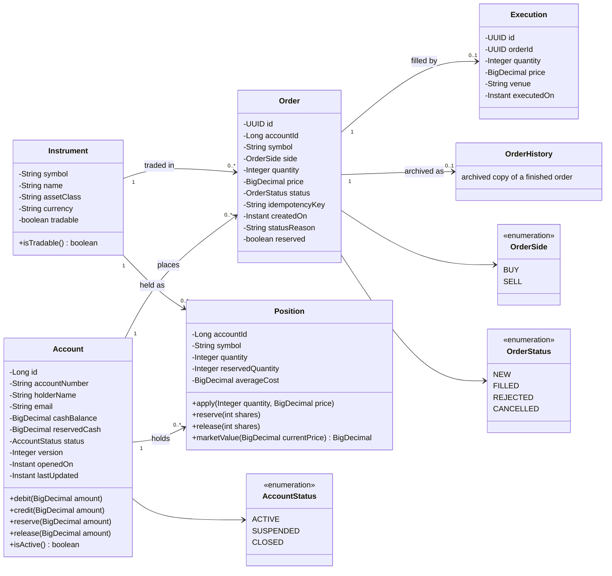
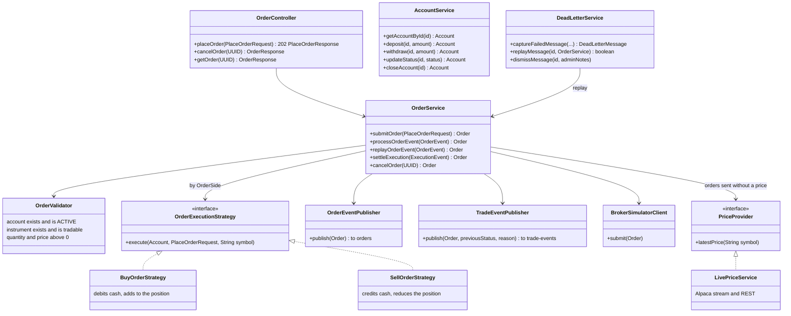
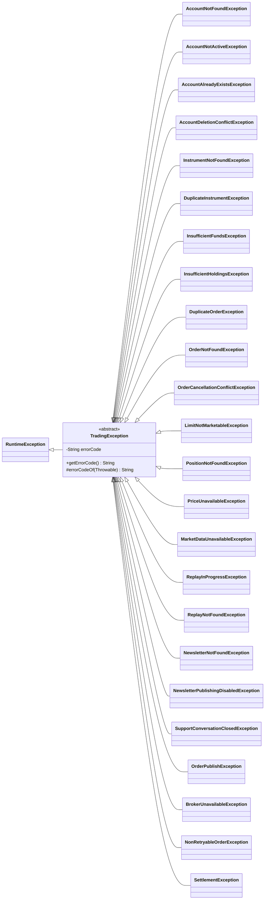

# Trading Domain Class Diagram

The core classes of the trading API (`src/main/java/com/neueda/leap`): the domain entities and
their behaviour, the order lifecycle enums, the services that run it, and the buy/sell
strategies. Getters, setters and Spring wiring are left out. GitHub renders the diagrams below.

The database tables behind the entities are in [ER-DIAGRAM.md](ER-DIAGRAM.md); how an order moves
through these classes is in [ORDER-FLOW.md](ORDER-FLOW.md).

## Domain model

- `Account.debit` throws `InsufficientFundsException` rather than letting the balance go below
  zero; `version` is the optimistic lock (NFR-02).
- `reserve` and `release` hold cash (`Account.reservedCash`) or shares
  (`Position.reservedQuantity`) for an accepted order until it fills, is rejected or is
  cancelled; `Order.reserved` says whether the order still holds them (`ReservationService`).
- `Position.apply` adds a fill to the holding and recomputes `averageCost`; a negative quantity
  is a sale.
- An `Order` is `NEW` from the moment the API accepts it until the broker's fill settles it
  (`FILLED`), a check fails (`REJECTED`) or the trader cancels it (`CANCELLED`).

## Services and strategies

- **Strategy pattern (SOLID: open/closed).** `OrderService` picks the strategy for the order's
  side from a `Map<OrderSide, OrderExecutionStrategy>`; adding a side means adding a strategy,
  not editing the service.
- **Dependency inversion.** Pricing is behind `PriceProvider`, so the order flow and its tests do
  not depend on Alpaca.
- **Single responsibility.** Validation (`OrderValidator`), execution rules (the strategies),
  messaging (the publishers) and the broker call (`BrokerSimulatorClient`) are separate classes.

## Exceptions

Every custom exception extends the abstract `TradingException`, which carries the spec error
code (§21). `GlobalExceptionHandler` returns that code with an HTTP status and a fixed, safe
message. The code's prefix names the part of the domain that failed (`ACC`, `INS`, `ORD`, `POS`,
`PRC`/`MKT`, `NWS`, `SUP`, `BRK`, `SYS`). The two Kafka wrappers, `NonRetryableOrderException` and
`SettlementException`, keep the code of the failure they wrap.

The exceptions extend `TradingException` directly. `Throwable`, `Exception` and
`RuntimeException` already make the tree three deep, so a further layer of category classes
would go past Sonar's inheritance limit (`java:S110`).

| Error code | HTTP | Exceptions |
|---|---|---|
| `ACC-404` | 404 | `AccountNotFoundException` |
| `ACC-403` | 403 | `AccountNotActiveException` |
| `ACC-409` | 409 | `AccountAlreadyExistsException`, `AccountDeletionConflictException` |
| `INS-404` | 404 | `InstrumentNotFoundException` (unknown or not tradable) |
| `INS-409` | 409 | `DuplicateInstrumentException` |
| `ORD-400` | 400 | `InsufficientFundsException` |
| `ORD-409` | 409 | `InsufficientHoldingsException`, `DuplicateOrderException`, `OrderCancellationConflictException` |
| `ORD-404` | 404 | `OrderNotFoundException` |
| `ORD-422` | 422 | `LimitNotMarketableException`: a BUY limit below the live price or a SELL limit above it |
| `POS-404` | 404 | `PositionNotFoundException` |
| `PRC-503`, `MKT-503`, `SYS-503` | 503 | `PriceUnavailableException`, `MarketDataUnavailableException`, `OrderPublishException` |
| `MKT-409` | 409 | `ReplayInProgressException`: a market replay is already running |
| `MKT-404` | 404 | `ReplayNotFoundException`: no bars for the requested day, or no replay is running |
| `NWS-404` | 404 | `NewsletterNotFoundException` |
| `NWS-403` | 403 | `NewsletterPublishingDisabledException`: early publishing is switched off |
| `SUP-409` | 409 | `SupportConversationClosedException`: a message posted to a closed support conversation |
| `SYS-409` | 409 | Spring's `OptimisticLockingFailureException`: two requests changed the same account at once, and its `version` column (NFR-02) refused the later one |
| `BRK-503` (internal) | | `BrokerUnavailableException`: the order is stored as REJECTED and can be replayed from the DLQ |
| cause's code (internal) | | `NonRetryableOrderException`, `SettlementException`: raised in the Kafka consumers, where they decide whether an order goes to the DLQ |
