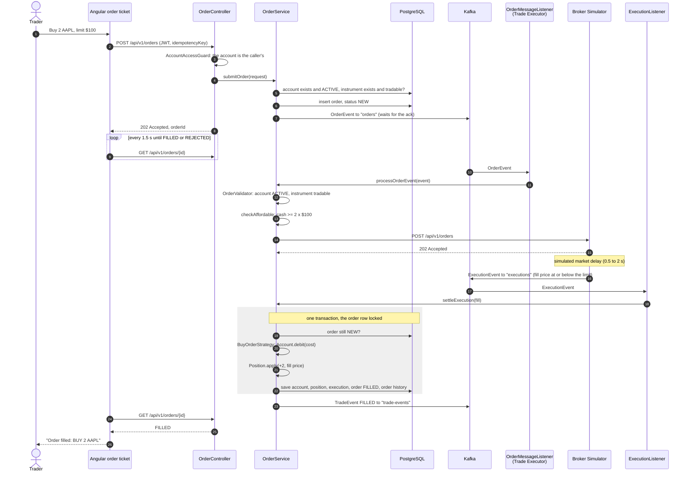
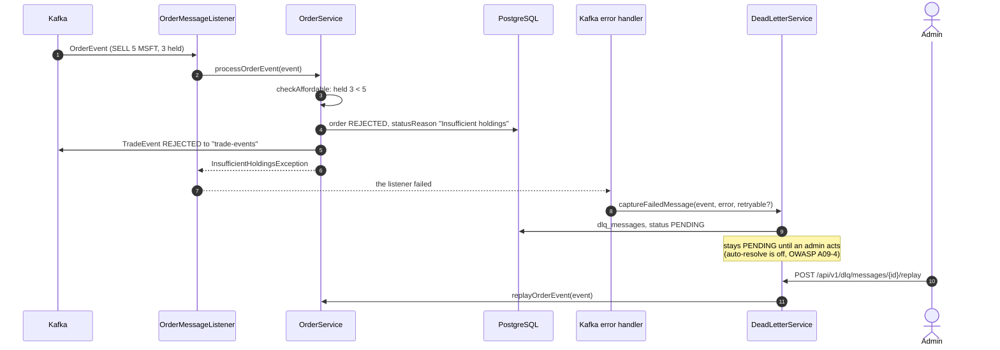
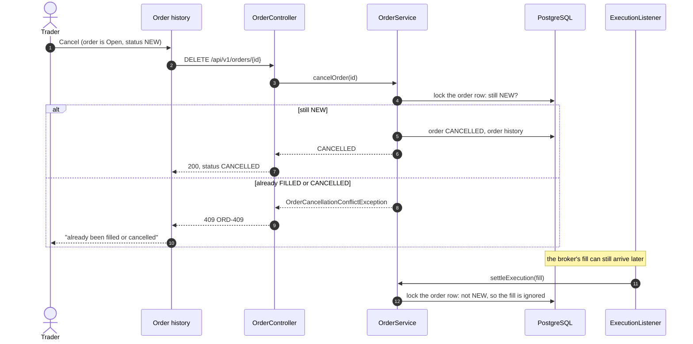

# Order Flow Sequence Diagrams

How an order moves through the platform, from the Angular order ticket to settlement. Orders
are asynchronous (docs/DECISIONS.md 2): the API accepts and queues an order, answers
`202 Accepted`, and the Trade Executor and the Broker Simulator fill it a moment later. The
classes named here are in [CLASS-DIAGRAM.md](CLASS-DIAGRAM.md). GitHub renders the diagrams below.

## 1. A BUY that fills

- **Idempotency (FR-06):** the client's `idempotencyKey` is stored with the order; reusing it
  answers `409 ORD-409`, so a retried request cannot place the order twice.
- **Audit (NFR-04):** every status change is published to `trade-events`, and
  `TradeEventAuditListener` stores it in `trade_event_log` (`GET /api/v1/orders/{id}/events`).
- **Fail fast:** an unknown account or instrument, an account that is not `ACTIVE` or an
  instrument that is not tradable is refused before anything is stored (`404 ACC-404`,
  `403 ACC-403`, `404 INS-404`). The Trade Executor checks again, in case either changes
  while the order waits. If Kafka cannot take the order, it is stored `REJECTED` and the API
  answers `503 SYS-503`.

## 2. A SELL, and an order that is rejected

A SELL takes the same path with `SellOrderStrategy`: `Account.credit(proceeds)` and
`Position.apply(-quantity, price)`, and the broker fills at or above the limit. What changes is
where a check can fail:

- The UI's polling sees `REJECTED` and shows the reason: `Insufficient holdings (ORD-409)`, or
  `Insufficient funds (ORD-400)` for a BUY the account cannot afford.
- **Retryable or not:** a missing account or instrument is `NonRetryableOrderException`, so its
  DLQ entry is marked non-retryable; a broker outage (`BrokerUnavailableException`) can be
  replayed once the broker is back.
- **At settlement:** the funds or holdings are checked again inside the settlement transaction.
  If they changed while the broker worked (for example, the trader withdrew cash), the fill is
  recorded as `REJECTED` instead of overdrawing the account.

## 3. Cancelling an open order

Both `cancelOrder` and `settleExecution` lock the order row, so a cancel and a fill can never
both win: whichever takes the lock first decides, and the other sees the order is no longer
`NEW`. Cash is only moved at settlement, so a cancelled order never spends anything.
