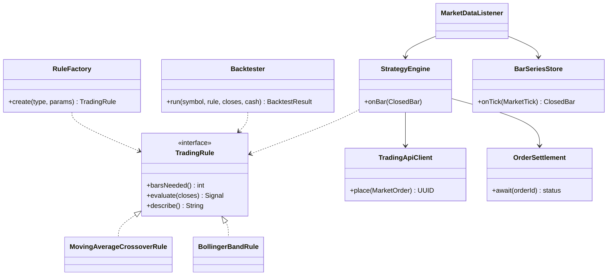

# Strategy Lab: how a strategy trades

The Sprint 10 extension (docs/DECISIONS.md 16). Prices reach the strategy service on the
`market-data` topic; it builds 1-minute bars, runs each ACTIVE strategy's rule on every bar that
closes, and places orders through the trading API like a trader, with its own STRATEGY token.

```mermaid
sequenceDiagram
    autonumber
    participant Alpaca
    participant API as Trading API
    participant K as Kafka
    participant S as Strategy service
    participant Auth as Auth service
    participant B as Broker simulator

    alt live
        Alpaca->>API: trade prices (WebSocket)
        API->>K: market-data LIVE (at most 1 per symbol per second)
    else replay (demo)
        API->>Alpaca: a past day's 1-minute bars
        API->>K: market-data REPLAY (up to 50 bars a second)
    end
    K->>S: price
    S->>S: close the 1-minute bar, run each ACTIVE strategy's rule
    opt rule fires: BUY while FLAT or SELL while LONG
        S->>Auth: POST /auth/token (client credentials, cached 14 min)
        Auth-->>S: access token, roles [STRATEGY]
        S->>API: POST /api/v1/orders (market order, idempotency key per strategy, bar and side)
        API->>API: STRATEGY may only trade for an account with an ACTIVE strategy
        API-->>S: 202 orderId
        API->>K: orders
        K->>API: Trade Executor
        API->>B: execute
        B->>K: executions
        K->>API: settle: FILLED (or REJECTED)
        S->>S: store the signal; wait for the order to settle, then move the position
    end
```


